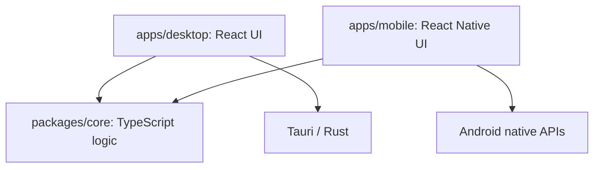

# ワークスペース構成

## 開発対象と現在の状態

Prelis は npm workspaces で管理するモノレポです。現在はデスクトップと Android の開発基盤があり、
Diary・Timer・Password を実装しています。機能仕様は [仕様書](specs/desktop-apps.md) に記載しています。
iOS のプロジェクトと起動コマンドは存在しますが、対応・ビルド検証は保留中です。

## 機能と UI の共有方針

[基本原則](../AGENTS.md)に従い、デスクトップとモバイルで提供する機能を共通にします。
機能はデスクトップで先に実装・動作確認し、その確認済みの内容をモバイルへ反映します。
この進め方による一時的な実装時期の差は、提供する機能の仕様差とは区別して管理します。

共通のロジックは `packages/core` に置き、UI は各アプリで別々に開発します。
モバイルでは画面サイズ、タッチ操作、画面遷移などの特徴に合わせて画面構成や操作方法を変更できます。
画面の見た目・構造の一致を前提とせず、共通機能の受け入れ条件をそれぞれの UI で満たします。

## 配置と責務

| 配置先 | 責務・主なファイル |
| --- | --- |
| `apps/desktop/src/` | React によるデスクトップ UI |
| `apps/desktop/src-tauri/` | Tauri の起動、Rust 処理、ウィンドウ・権限・配布設定 |
| `apps/desktop/vite.config.ts` | Web フロントエンドの開発サーバーとバンドル設定 |
| `apps/mobile/App.tsx`・`src/` | React Native の UI。`index.js` から登録 |
| `apps/mobile/metro.config.js` | モノレポ内のソース監視・JavaScript の解決設定 |
| `apps/mobile/android/` | Android の Gradle 設定、Kotlin の起動処理、リソース |
| `apps/mobile/ios/` | iOS のネイティブプロジェクト（対応保留） |
| `packages/core/src/` | 両アプリが利用する UI・OS に依存しない TypeScript ロジック |
| `scripts/` | ルートの開発コマンドを支える補助処理 |
| `docs/` | 構成説明、規則、手順、仕様、環境メモ |
| `ref/` | Git 管理対象外の参考資料。通常の実装・検証の対象外 |

ルートの [package.json](../package.json) が `apps/*` と `packages/*` を workspace として定義し、
[package-lock.json](../package-lock.json) が npm の依存解決を固定します。
Rust の依存は [Cargo.toml](../apps/desktop/src-tauri/Cargo.toml) と
[Cargo.lock](../apps/desktop/src-tauri/Cargo.lock) で管理します。ルートの Cargo workspace はありません。

## 依存方向

共有ロジックはアプリを参照しません。画面や OS の API を使う処理は各アプリが担当し、
共有処理が必要とする場合は関数・インターフェースを通して渡します。
アプリ同士のソースを直接 import する構成にはしていません。

## core の公開エントリ

両アプリは `@prelis/core` を依存として宣言し、npm workspace のリンクを通じて解決します。
[core の package.json](../packages/core/package.json) の exports は次の構成です。

| 利用条件 | 解決先 |
| --- | --- |
| `types` | `src/index.ts` |
| `browser`（Vite） | `src/index.ts` |
| `react-native`（Metro） | `src/index.ts` |
| `default`（通常の Node.js import など） | `dist/index.js` |

Vite・Metro はソースを直接変換するため、アプリ開発時に core の事前ビルドや別の watch プロセスは不要です。
Node.js 向けの成果物を使用する場合は `npm run build:core` で JavaScript と型宣言を生成します。
`dist/` は Git 管理対象外です。

## デスクトップの起動・ビルド経路

ルートのコマンドから Tauri CLI を起動します。
[tauri.conf.json](../apps/desktop/src-tauri/tauri.conf.json) の `beforeDevCommand` が Vite を起動し、
Tauri はポート 1420 の画面を読み込みます。
ビルド時は `beforeBuildCommand` が型チェックと Vite ビルドを実行し、
`apps/desktop/dist/` を Tauri の `frontendDist` として取り込みます。

## Android の起動・ビルド経路

Metro が JavaScript を変換し、Gradle が Android アプリをビルドします。
通常の debug APK は起動中の Metro（ポート 8081）から JavaScript を読み込みます。
[android-gradle.mjs](../scripts/android-gradle.mjs) は `apps/mobile/android/` を作業ディレクトリとして
同梱の Gradle wrapper を呼び出します。

モノレポ用の依存パスは2箇所に設定されています。

- [settings.gradle](../apps/mobile/android/settings.gradle): ルートの `node_modules/@react-native/gradle-plugin` を参照。
- [app/build.gradle](../apps/mobile/android/app/build.gradle): `reactNativeDir`・`codegenDir`・`cliFile` をルートの `node_modules/` へ設定。

[Metro 設定](../apps/mobile/metro.config.js) はリポジトリルートを `watchFolders` に含めます。
`nodeModulesPaths` にルートの依存を指定し、パッケージ固有のネストされた依存を解決できるよう
通常の階層探索も有効にしています。

React はルートの `overrides` と lockfile により両アプリ・推移的依存で同一バージョンに揃えています。
更新方針は[開発規則](development/rules.md)、検証範囲は[作業手順](development/workflow.md)を参照してください。
