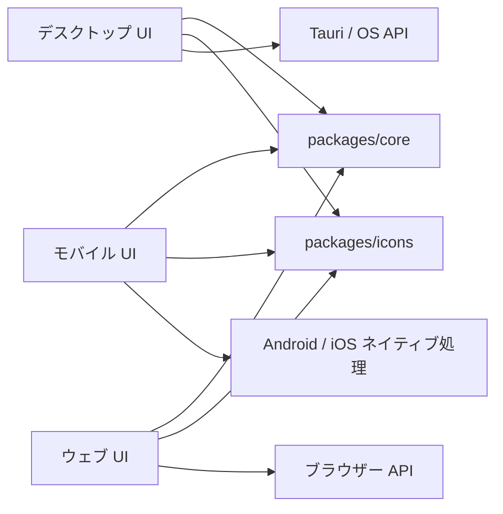

# 全体構成

このリポジトリは、デスクトップ・モバイル・ウェブのアプリと共有パッケージを、TypeScript を中心としたモノレポで管理します。
開発方針と命名規則は [AGENTS.md](../../AGENTS.md)、視覚・操作デザインは [design-guidelines.md](design-guidelines.md) を参照してください。

## 配置と責務

| 配置先 | 役割・主な技術 |
| --- | --- |
| `apps/desktop/` | デスクトップアプリ。`src/` は React + Vite の UI、`src-tauri/` は Tauri + Rust のネイティブ処理・権限・配布設定 |
| `apps/mobile/` | モバイルアプリ。`App.tsx`・`src/` は React Native の UI、`android/` は Kotlin・Gradle、`ios/` は Swift・Objective-C・Xcode のネイティブ処理・設定 |
| `apps/web/` | ウェブアプリ。React + Vite の UI とブラウザー API に依存する処理 |
| `packages/core/` | UI・OS に依存しない TypeScript の共有ロジック |
| `packages/icons/` | 共通アイコン・ブランド画像。`assets/` の PNG を正本として各アプリで使用 |
| `lp/` | 製品紹介・ダウンロード案内用の Next.js 静的サイト。ウェブアプリとは別で、ルートの npm workspaces 管理外 |
| `scripts/` | OS 別の開発・ビルド・署名・配布を支える補助スクリプト |
| `infra/` | LP・ウェブアプリ・APT・MSI の配信基盤を定義する Terraform と公開用スクリプト |
| `dist/` | 配布物の出力先と、ストア掲載文・リリースノートなどの配布用資料 |
| `docs/` | 現行の開発資料・環境メモ |
| `docs-old/` | 整理前の資料。過去の仕様・手順・検証記録の参考用で、現行実装との一致は保証しない |
| `ref/` | Git 管理対象外の参考資料。通常の実装・検証の対象外 |

デスクトップとウェブの `src/` は、`shell/` が画面切り替え、`apps/<機能名>/` が各機能、`shared/` がアプリ内の共通 UI を担当します。

デスクトップの環境準備・起動・バージョン更新は [desktop.md](desktop.md)、Linux 配布物のビルド・署名・検証は [sign.md](dist/linux/sign.md) を参照してください。

## 依存関係と実装の境界



- UI は各アプリで実装し、アプリ同士のソースを直接 import しません。
- 共通ロジックは `packages/core` に置き、DOM・React Native・Tauri の API を持ち込みません。環境に依存する処理が必要なら関数・インターフェースとして渡します。
- core は公開エントリ `@prelis/core` から利用します。アイコンは `@prelis/icons` の型と `@prelis/icons/assets/*.png` を利用します。

## 依存管理

- アプリと共有パッケージは、ルートの [package.json](../../package.json) が定義する npm workspaces（`apps/*`・`packages/*`）で管理し、依存解決はルートの [package-lock.json](../../package-lock.json) で固定します。
- Node.js の基準は [.nvmrc](../../.nvmrc) の 24.19.0、許容範囲と npm の要件はルートの `package.json` の `engines` に定義します。React 関連の共通バージョン指定はルートの `overrides` にあります。
- [core の exports](../../packages/core/package.json) は、型・ブラウザー・React Native 向けに TypeScript ソースを、通常の Node.js 向けに `dist/` の JavaScript を公開します。
- Rust の依存は `apps/desktop/src-tauri/` の `Cargo.toml`・`Cargo.lock`、LP の npm 依存は `lp/frontend/app/` の `package.json`・`package-lock.json` で別に管理します。

## 共通セットアップ

以下のコマンドは、リポジトリのルートで実行します。

### 初回セットアップ

Node.js のバージョン管理には fnm を使用します。
fnm のインストールと使用するシェルへの初期化設定を済ませてから、以下を実行してください。
`fnm install` と `fnm use` は、ルートの `.nvmrc` に指定されたバージョンを使用します。

```sh
fnm install
fnm use

npm ci
npm run check
```

`npm ci` はルートの lockfile に従って依存をインストールします。
既存の `node_modules/` は再作成されるため、開発サーバーを停止した状態で実行します。

`npm run check` は全 workspace の型チェック、モバイルの lint・Jest（Watchman 不使用）、core の生成ロジックテスト、ウェブの仕様テストを順に実行します。
ネイティブビルドは含まれません。コマンドの定義元はルートの [package.json](../../package.json) です。

### 依存の追加・更新

依存追加はルートから対象の workspace を指定します。以下は書式例で、実際のパッケージ名に置き換えます。

```sh
npm install <package> -w apps/desktop
npm install <package> -w apps/mobile
npm install <package> -w apps/web
npm install -D <package> -w packages/core
```

React 関連の変更時は宣言・ルートの `overrides`・lockfile を揃え、解決結果を確認します。

```sh
npm ls react react-dom react-test-renderer --all
```

通常のアプリ開発は core の生成物に依存しません。
Node.js から core を使う作業では、ソース変更後に `npm run build:core` を実行します。
